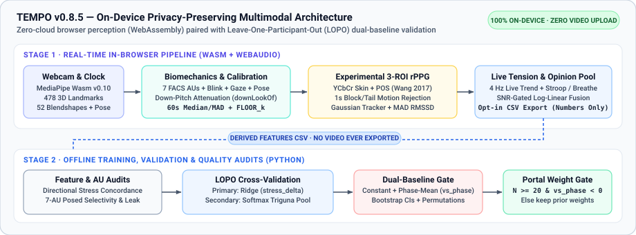
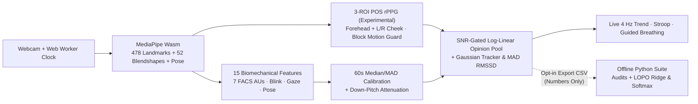

<div align="center">

# Tempo

**Privacy-Preserving On-Device Multimodal Stress & Affect Estimation**

[](VERSION.txt)
[](#testing--verification)
[](#privacy-invariant)
[](STUDY_PROTOCOL.md)
[](#quantitative-benchmarks-synthetic-v085)

*Zero-cloud webcam & pose perception in WebAssembly + robust within-subject calibration + Leave-One-Participant-Out ML evaluation.*

[Quick Start](#quick-start) · [Architecture](#system-architecture) · [Math & Calibration](#mathematical-pipeline) · [Benchmarks](#quantitative-benchmarks-synthetic-v085) · [Project Structure](#project-structure)

</div>

---

> **Evaluation Scope:** Predicting self-reported change-from-baseline stress (`stress_delta`) is the primary supervised target. Compositional Triguna (*Sattva*, *Rajas*, *Tamas*) is a secondary course-demo layer (`DEMO_GUNA = false` by default). The default portal tension weights (`TENSION` in [`app.js`](app.js)) are unvalidated priors and are dynamically swapped for LOPO-fitted weights **only** when `N >= 20` and `vs_phase < 0`. Quantitative numbers below come from automated synthetic benchmarks (`49/49` JS tests + `20`-participant synthetic LOPO runs); multi-participant real-face cohort studies remain ongoing.

---

## System Architecture

Tempo processes all camera frames locally in volatile browser RAM via **MediaPipe WebAssembly** (`FaceLandmarker` + `PoseLandmarker`), extracts 15 biomechanically grounded features relative to each person's own 60 s resting baseline, and exports **only derived numerical telemetry** when the user explicitly clicks **Export CSV** for offline **Leave-One-Participant-Out (LOPO)** evaluation in Python.

<p align="center">
  
</p>



---

## Quick Start

Tempo requires **no backend, no database, and no API keys**. Because browsers restrict camera access and ES modules over `file:///`, launch via a local HTTP server from the project root:

### 1. Run the Browser Portal
```bash
# Option A: Python built-in server (zero dependencies)
python3 -m http.server 8000
# Open http://localhost:8000 in Chrome, Edge, or Brave

# Option B: One-command automated setup & launch scripts
./installation && ./tempo_run
# Windows: double-click installation.bat then tempo_run.bat
```

### 2. Run the Automated Test Suite (Node.js 22+)
```bash
npm ci
npm run check   # Strict syntax check across all 9 JS modules
npm test        # 49/49 unit, DOM contract, rPPG, and dropout tests
```

### 3. Run the Python Audit & LOPO Training Pipeline
```bash
pip install -r requirements.txt
mkdir -p data
python3 tools/make_synthetic.py signal data/sessions.csv
python3 tools/audit_features.py data/sessions.csv
python3 train_guna.py
```

### 4. Interactive 3-Minute Evaluation Walkthrough
| Phase | Duration | What Happens |
| :--- | :--- | :--- |
| **1. Baseline** | `20s` settle + `60s` cal | Captures resting facial & postural baseline (`Median` + `1.4826 · MAD` with variance `FLOOR_k`) |
| **2. Stressor** | `~90s` | Built-in **7-Color Rotating Stroop** challenge (`stroop.js`); tracks brow furrow (`AU4`), lid tightening (`AU7`), blink suppression, and interference latency |
| **3. Recovery** | `~90s` | **Guided Breathing Coach** (`breathe.js`: `4-7-8`, `Box`, `5-5` Coherent); monitors parasympathetic recovery toward baseline |
| **4. Summary** | End | View phase-by-phase directional agreement (`summary.js`) and optionally export derived telemetry CSV |

---

## Mathematical Pipeline

### Within-Subject Robust Baseline Calibration (`app.js`)
Static population thresholds misclassify neutral facial anatomy (e.g., naturally narrow eyes or deep brow arches). Tempo normalizes every feature $x_k(t)$ exclusively against the user's own 60 s calm baseline:

$$s_k = \max\big(1.4826 \cdot \text{MAD}_k,\; 0.1|m_k|,\; \text{FLOOR}_k\big), \qquad z_k(t) = \operatorname{clip}\!\left(\frac{x_k(t) - m_k}{s_k},\; -3,\; +3\right)$$

When the head pitches downward (`downLookOf` — e.g., reading a desk sheet or phone), `attenuateDownLook()` attenuates foreshortening-induced false brow/eyelid spikes.

### Experimental 3-ROI Motion-Protected rPPG (`hr.js`)
* **3-ROI Quality-Weighted POS Consensus (`fuseRois`):** Tracks forehead, left cheek, and right cheek independently under $YC_bC_r$ skin masking; tolerates single-cheek occlusion ($\ge 2/3$ slots with $\ge 80\%$ coverage).
* **Block & Tail Motion Rejection (`motionBlocks`):** Flags 1 s blocks (and partial trailing segments) where despiked green spread exceeds `3x` clean reference or raw forehead landmark excursion exceeds `0.08` face widths; freezes tracker state instead of locking onto head-nod harmonics.
* **Anti-Hopping Gaussian Affinity & Ectopy Filtering:** Scores spectral peaks with Gaussian distance weighting around the locked HR and rejects ectopic inter-beat intervals via $3\sigma_{\text{MAD}}$ gating before computing HRV (`RMSSD`).

### Dual-Baseline LOPO Evaluation & Dropout Fusion (`train_guna.py`, `app.js`)
* **Strict Leave-One-Participant-Out (LOPO):** Windows are never split across train/test folds; every participant and self-report receives equal total weight.
* **Mandatory Dual Baselines:** Reports MAE and soft cross-entropy against both a **Constant Baseline** (`vs_mean`) and a **Phase-Mean Baseline** (`vs_phase`) with participant-resampled bootstrap confidence intervals.
* **Quality-Gated Log-Linear Opinion Pool (`fuse`):** Dynamically renormalizes weights over valid modalities ($q_m \ge 0.3$) and cleanly abstains (`null`) if all channels degrade.

---

## Quantitative Benchmarks (Synthetic `v0.8.5`)

<details>
<summary><strong>1. rPPG Signal &amp; Motion Regression Benchmarks (17 Scenarios · <code>tests/hr.test.mjs</code>)</strong></summary>

| Scenario | `v0.8.5` Valid % | `v0.8.5` MAE (bpm) | Baseline POS (`v0.4`) MAE / Behavior |
| :--- | :---: | :---: | :--- |
| `clean60` (60 bpm clean pulse) | `100%` | `0.2` | `0.2` |
| `fast120` (no half-rate lock) | `100%` | `0.1` | `0.1` |
| `harmonicDominant` (holds fundamental) | `100%` | `0.0` | `60.1` (`v0.4` doubles fundamental) |
| `motionBurst` (4 s motion transient) | `86%` | `0.2` | `9.5` |
| `motionHijack` (10 s 51 bpm head-motion) | `76%` | `0.28` | `3.82` (never hijacked) |
| `subROI` fused vs. pooled (51 bpm forehead artefact) | `100%` | `0.21` | Pooled fails at `16.96` MAE |
| `noiseOnly` (white noise rejection) | `0%` | `NaN` | `52.9` (`0%` false positives) |

</details>

<details>
<summary><strong>2. LOPO Stress Regression, Modality Dropout &amp; Feature Audits (20 Synthetic Participants)</strong></summary>

| Check / Model | Result (`v0.8.5`) | Baseline / Acceptance Gate |
| :--- | :--- | :--- |
| **`stress_delta` (LOPO Ridge, 15 features)** | `MAE = 0.072`, Spearman $\rho = 0.819$ | Beats Constant (`vs_mean = -0.082`) & Phase-Mean (`vs_phase = -0.021`) |
| **Portal `stress_tension` Gate** | `N = 20`, `vs_phase = -0.016` | Swaps priors for fitted weights only when `N >= 20` & `vs_phase < 0` |
| **Intermittent Channel Dropout** | `49/49` tests pass | Renormalizes `face+rppg+pose` → `face+pose` → `face` → `null` abstention |
| **Directional Stressor Concordance** | `10/11` concordant (`sign_p < 0.001`) | Session $\times$ phase Spearman $\rho = 0.783\text{–}0.906$; flags inverse synthetic `blink` |
| **7-AU Posed Selectivity (`--posed --au`)** | Leak ratios `0.003–0.200` | Passes $\le 0.50$ cross-talk gate across all 7 FACS AUs (`browLower`..`smile`) |

</details>

---

## Privacy Invariant

* **Zero Video Streaming:** Video and audio frames are processed strictly in volatile browser RAM via WebAssembly.
* **No Image Storage:** No frames, video clips, or snapshots are ever written to disk, logged, or uploaded.
* **Opt-In Numerical Export:** Only derived feature z-scores, phase tags, and optional self-reports are exported locally as CSV when explicitly requested.

---

## Project Structure

```text
tempo/
├── index.html, styles.css          # Semantic responsive UI with Apple-style design tokens
├── app.js, ui.js                   # MediaPipe Wasm pipeline, Median/MAD calibration, opinion pool
├── hr.js                           # Experimental 3-ROI POS rPPG, motion guard & MAD-ectopy RMSSD
├── chart.js, summary.js            # 4 Hz zone-colored SVG trend visualizer & session summary modal
├── stroop.js, breathe.js           # Built-in 7-color Stroop stressor & guided breathing coach
├── affect.js, voice.js             # Circumplex facial affect & opt-in on-device WebAudio voice hook
├── train_guna.py                   # LOPO Ridge/Softmax training, dual baselines & models.json export
├── tools/
│   ├── audit_features.py           # Directional stressor concordance & 7-AU posed selectivity audit
│   ├── audit_posed_expressions.py  # Standalone posed FACS Action Unit audit wrapper
│   ├── evaluate_rppg.py            # Offline rPPG trace evaluation utility
│   └── make_synthetic.py           # Synthetic 20-participant cohort generator for CI & smoke checks
├── tests/
│   ├── ui.test.mjs                 # 24 DOM contract, trend, Stroop, breathing & dropout fusion tests
│   └── hr.test.mjs                 # 25 rPPG waveform, sub-ROI occlusion & motion-rejection tests
├── launcher/                       # Go cross-platform standalone offline executable builder
└── docs/                           # Architecture spec, patent prior-art benchmark, protocol & assets
```

---

## Documentation & Governance

* [`STUDY_PROTOCOL.md`](STUDY_PROTOCOL.md) — 3-phase data collection protocol (`baseline` → `stressor` → `recovery`).
* [`DATA_SCHEMA.md`](DATA_SCHEMA.md) — Definitions for all exported telemetry columns (`tension_source`, quality gates, labels).
* [`docs/PATENT_PRIOR_ART_BENCHMARK_REPORT.md`](docs/PATENT_PRIOR_ART_BENCHMARK_REPORT.md) — Technical comparison against 8 prior-art patents (1999–2024) and 4 peer-reviewed benchmarks.
